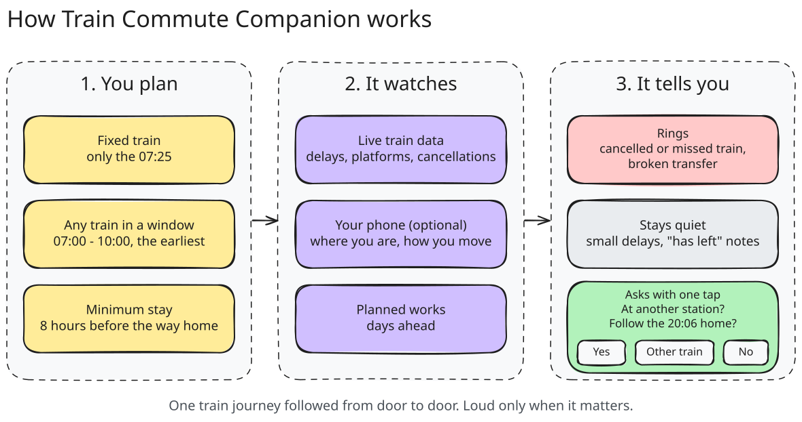
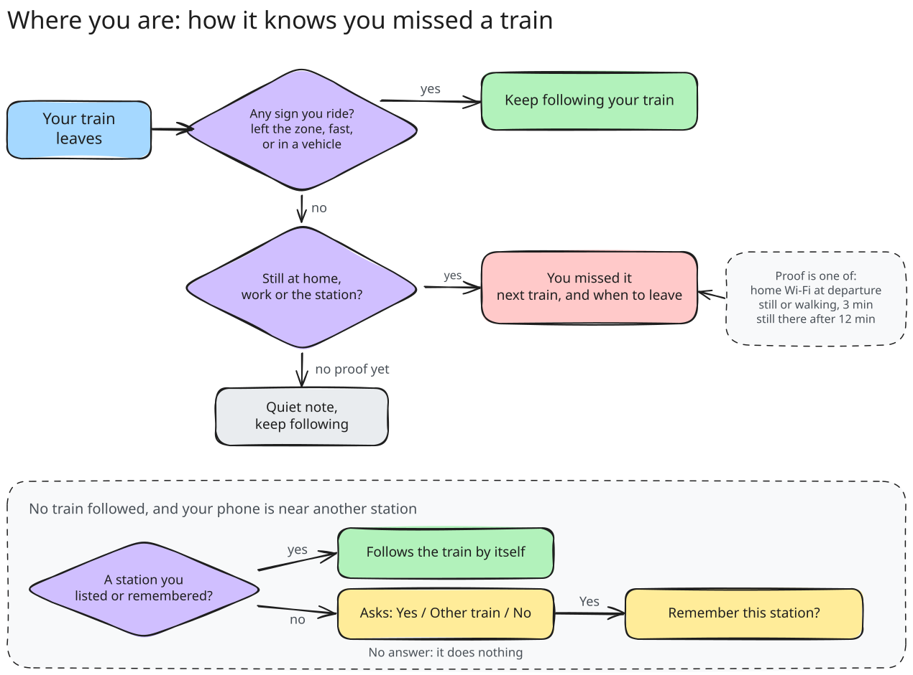

# Train Commute Companion

[](https://hacs.xyz/docs/faq/custom_repositories/)
[](https://github.com/rhnfzl/train-commute-companion/actions/workflows/validate.yml)
[](https://github.com/rhnfzl/train-commute-companion/releases)
[](https://github.com/rhnfzl/train-commute-companion/pkgs/container/train-commute-companion)
[](https://pypi.org/project/train-commute-companion/)
[](https://www.home-assistant.io/)
[](LICENSE)

Get an alert when delays, cancellations, platform changes or missed connections affect your usual train journey.

Choose a fixed train or any train within a time window.

Data: NS. You bring your own [NS API key](docs/ns-api-key.md); none is bundled. This project is not made by or linked to NS.

[](https://my.home-assistant.io/redirect/hacs_repository/?owner=rhnfzl&repository=train-commute-companion&category=integration)
[](https://my.home-assistant.io/redirect/config_flow_start/?domain=train_commute_companion)

## What it does

<picture>
  <source media="(prefers-color-scheme: dark)" srcset="https://raw.githubusercontent.com/rhnfzl/train-commute-companion/main/docs/images/how-it-works-dark.svg">
  
</picture>

- **Follows your trains.** You describe your usual trips once, in a small YAML file, with station names such as `Utrecht Centraal` or NS codes such as `UT`. On a travel day it picks your train and watches it.
- **Tells you what changed.** Delays, cancellations, platform changes, a train cut short, a new route, a transfer at risk or broken, and a train you missed.
- **Suggests what to do.** When your train no longer works, it names the best train you can still catch.
- **Shows when to leave.** Check-in and pre-trip advice use your travel buffer; a delayed train never moves leave-by later. [Settings](docs/profile-editor.md#check-in-and-leave-by-times).
- **Looks ahead.** It warns you about planned works on your route. Choose how many calendar days or upcoming commute dates to check. [Timetable lookahead](docs/profile-editor.md#timetable-lookahead).
- **Summarizes the week.** An optional [works digest](docs/weekly-works-digest.md) checks seven calendar days and labels unknown coverage.
- **Shows how your commute went.** See your on-time rate and delays in [local commute statistics](docs/commute-statistics.md).
- **Tracks replacement transport.** Follow reviewed bus, walk and metro plans with explicit boarding and arrival confirmations. [Replacement transport](docs/replacement-transport.md).
- **Shows crowd forecasts.** NS forecasts appear with your trains and alternatives; changed forecasts can send silent updates. [Crowd forecasts](docs/crowd-forecasts.md).
- **Changes plans and alerts.** Resume a skipped journey and control quiet or paused notifications in [Home Assistant](docs/home-assistant.md).
- **Pauses for holidays.** Set an inclusive date range and monitoring resumes afterward. [Holiday pauses](docs/holiday-pauses.md).
- **Uses weekday departure times.** Set different first trains within one profile while preserving already-followed journeys. [Schedules](docs/weekday-schedules.md).
- **Follows any train in a time window.** No usual train needed, with an optional minimum stay and settings per day. [Schedules](docs/weekday-schedules.md#window-mode).
- **Plans around when you need to arrive.** Set an arrival target, include your walk, and choose how much earlier you would leave for a direct train. [Arrive by](docs/weekday-schedules.md#arrive-by-a-set-time).
- **Notices another boarding station.** With location on, it follows a known station by itself and asks once at a new one. [Other boarding station](docs/other-boarding-station.md).
- **Shows train context.** Optional NS composition, listed capacity and candidate vehicle coordinates include source limits. [Train context](docs/train-context.md).
- **Shows commute weather.** Station forecasts and tips need no key. Weather can suggest extra minutes in leave-by text. Official KNMI warnings need your own key. [Weather](docs/weather.md).
- **Loud only when it matters.** Alerts you must not miss ring; small updates arrive silently.
- **Says when NS is unclear.** When NS gives two different answers about the same train, you get both, so you can decide.

## Ways to run it

| Way | What you get | Guide |
| --- | --- | --- |
| Home Assistant (HACS) | Alerts on your phone through the companion app, sensors and buttons | [docs/home-assistant.md](docs/home-assistant.md) |
| Docker | Alerts and guided travel plans in a private Telegram chat (amd64 and arm64) | [docs/docker.md](docs/docker.md) |
| ntfy | One-way phone push without Home Assistant or Telegram; your own private topic and access token | [docs/ntfy.md](docs/ntfy.md) |
| Household | A separate Docker companion and private bot for each traveller | [docs/household.md](docs/household.md) |
| Webhooks | Each alert as signed JSON to your own URL, from Docker or Home Assistant | [docs/webhooks.md](docs/webhooks.md) |
| Email | Optional encrypted SMTP copies alongside ntfy or Telegram in Docker | [docs/email.md](docs/email.md) |
| Today | Private journey and service status with browser refresh, a home screen shortcut and optional sent-alert history | [docs/docker.md](docs/docker.md#today-web-status) |
| MCP | Journey status and optional plan management for local or private-network agents | [docs/mcp.md](docs/mcp.md) |

Location (optional) helps it know when you leave and where you are. See [Where you are](#where-you-are) below.

Profiles can request [accessible journeys](docs/accessibility.md) and disable [notification categories](docs/notification-preferences.md). These settings also appear in the Home Assistant profile form.

Save an [explicit arrival](docs/compensation-reminders.md) to compare it with the original plan and optionally check NS compensation rules. The companion does not decide eligibility. Today also offers deliberate calendar and offline route-preview downloads.

Docker can keep one silent [journey status pin](docs/docker.md#pinned-telegram-status) up to date in your confirmed private Telegram chat.

## Quick start (Home Assistant)

1. In HACS, add `https://github.com/rhnfzl/train-commute-companion` as a custom repository of type Integration, or use the button above.
2. Download Train Commute Companion and restart Home Assistant.
3. Add the integration under Settings, Devices and services, and enter your NS API key.
4. Choose stations and trains in the forms that follow, or turn on **Use an existing YAML file** to use a [profiles file](examples/profiles.yaml) you already have.

The full guide is in [docs/home-assistant.md](docs/home-assistant.md).

## Where you are

A timetable app knows your train. It does not know where you are. With location on, the companion can:

- see that you are still at home when your train leaves, and tell you the next train and when to leave;
- see that you are on the train, so a late phone position does not cause a false "you missed it";
- pick the next train you can catch when you leave home before your usual train leaves.
- notice that you are at another station and follow a train from there, or ask you first.

Phones often report a position minutes late. A position just after the departure does not prove a miss. The companion also checks movement, Wi-Fi, activity and time:

<picture>
  <source media="(prefers-color-scheme: dark)" srcset="https://raw.githubusercontent.com/rhnfzl/train-commute-companion/main/docs/images/where-you-are-dark.svg">
  
</picture>

Activity counts only when reported after the departure and at most 5 minutes ago. Without proof the train stays followed, and you may get a quiet "has left. If you are not on it, next train" note. Regular train alerts still apply. Full rules: [Missed trains](docs/location-ha.md#missed-trains) and [Other boarding station](docs/other-boarding-station.md). Other sources: [OwnTracks](docs/location-owntracks.md), [Telegram](docs/location-telegram.md).

### Phone setup (Home Assistant companion app)

1. **Location: Always.** iOS: Settings, Privacy & Security, Location Services, Home Assistant: Always, Precise Location on. Android: Allow all the time.
2. **Motion (optional, recommended).** iOS: the app does not ask by itself. In the app open Settings, Companion App, Sensors, tap the blue **Motion** link and allow access, then enable **Activity**. Android: enable Detected activity. [Details](docs/location-ha.md#phone-setup).
3. **Check it.** In Home Assistant, Developer tools, States: your phone tracker has `latitude` and `longitude`, and the activity sensor is not `unavailable`.

Then add the `location` block to your profile. Steps and the optional Wi-Fi tracker: [Location with Home Assistant](docs/location-ha.md).

## The Python core

The core is a typed Python library on PyPI. It has no Home Assistant code.

It is released for its two shells, the Home Assistant integration and the Docker app, so its module APIs can change between versions. The supported entry point is the `tcc` command: `check-profile`, `replay` and `run`.

```bash
pip install train-commute-companion
tcc check-profile profiles.yaml
```

## Development

```bash
uv run --extra app pytest -q        # core and app tests (the extra installs the MCP SDK)
uv run --extra app mypy src app/tcc_app
# the published floors: Python 3.12, httpx 0.27, PyYAML 6.0.1 and mcp 2.3
uv run --no-cache --isolated --no-project --python 3.12 --with '.[app]' --with httpx==0.27.0 --with PyYAML==6.0.1 --with mcp==2.3.0 --with pytest --with pytest-asyncio pytest -q tests tests_app
uv run ruff check src tests tests_ha tests_app tests_live custom_components app

# Home Assistant integration: Python 3.14.2+, in its own environment
export UV_PROJECT_ENVIRONMENT=.venv-ha
uv run --python 3.14 --group ha pytest tests_ha -q
uv run --python 3.14 --group ha mypy --explicit-package-bases --namespace-packages -p custom_components.train_commute_companion
```

The [Validate workflow](.github/workflows/validate.yml) runs these same commands, and a release runs them before it publishes. Each night it also runs `tests_ha` against the newest Home Assistant test package, because the integration calls private `mobile_app` code.

[Live NS checks](docs/live-testing.md) run separately with your own key and capture alerts locally.

## License

[Apache-2.0](LICENSE)
