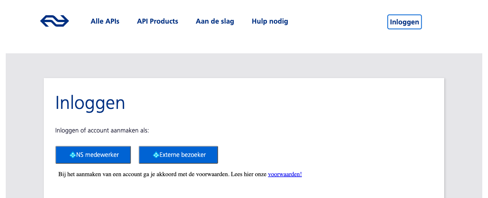
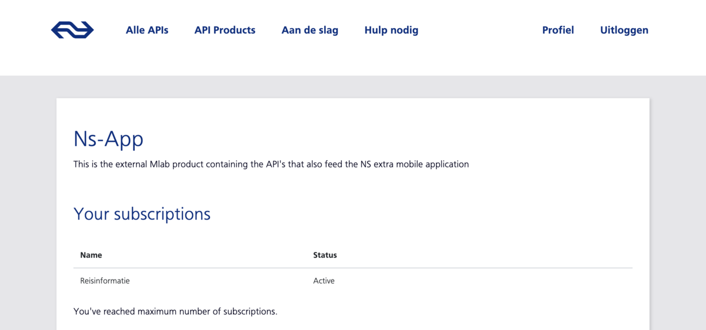
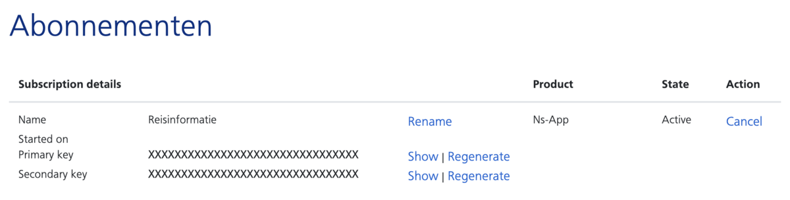

# Get an NS API key

The companion reads train data from the NS travel information API. You need your own free key for it. The NS API portal is in Dutch, so the button names below are in Dutch too.

## Steps

1. Open the [NS API portal](https://apiportal.ns.nl) and choose **Inloggen** (log in).
2. Choose **Externe bezoeker** (external visitor), create an account and send the form.

   

3. You get an email that your account is ready. It can take up to 5 minutes before the APIs show in the portal. Each time you log in, the portal emails you a verification code.
4. Log in, open **API Products** and choose the [Ns-App product](https://apiportal.ns.nl/product#product=NsApp). It includes the Reisinformatie API that the companion uses.
5. Under **Your subscriptions**, accept the terms if they are shown, type a name for the subscription (the product name is fine) and choose **Subscribe**. An account can hold one subscription per product.

   

   This account already has its subscription, so the page says it reached the maximum. A new account sees the subscribe form there instead.

6. The portal opens your profile page with the status of the request. If NS needs to approve it, you hear back by email.
7. Once the state is Active, open your [profile page](https://apiportal.ns.nl/profile). Under **Abonnementen** the subscription has a primary and a secondary key. Choose **Show** to see a key. Either one works.

   

Using the NS APIs is free, but each product has a limit on the number of calls. NS sets that limit and can change it.

## Where the key goes

- **Home Assistant:** the integration asks for the key when you add it. See [Set up](home-assistant.md#set-up).
- **Docker:** put it in your `.env` as `NS_API_KEY`. See [Docker](docker.md).

## Keep it private

Treat the key like a password: keep it out of profile files, screenshots and issues. To change it in Home Assistant, see [Replace an NS API key](home-assistant.md#replace-an-ns-api-key). With Docker, change `NS_API_KEY` in `.env` and recreate the container, as [Docker](docker.md) describes.
